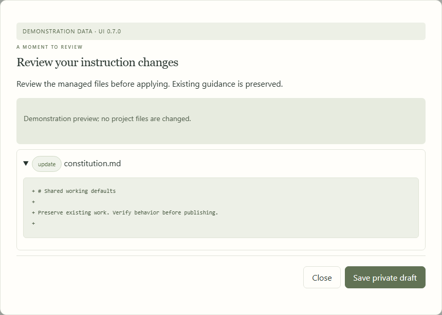
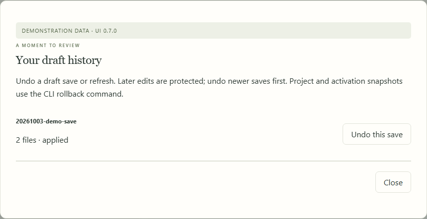

# Constitution files in Local Control

Choose **Instructions → Shared library** in the dashboard to search and read the shared library, then edit its instructions and configuration in a private draft. The controller includes this feature; workers only need their existing paired node service.

The published private Studio library is created lazily from the controller's bundled library under `<local-control-state>/studio/library`. With standard paths this is `~/.config/ai-constitution/local-control/studio/library`. It is separate from the public checkout, immutable installed releases, private policy overlays, and client settings.

## Save, review, activate

1. Open `constitution.md`, `engineering.md`, another instruction module, or a configuration file. Use the search field or **Customized files only** filter.
2. Edit the text. **Review & save draft** validates the whole library and shows the changed source plus generated adapters/routing. Invalid JSON or broken references prevent saving.
3. Save an isolated candidate. No following project changes. Open **Instructions → Saved drafts** to review publication. Publishing revalidates fingerprints and records a rollback snapshot. Following projects then synchronize under their existing pins, pauses and conflict rules. See the [draft migration guide](projects-first-usability.md#save-a-draft-then-publish).
4. **Preview activation** additionally shows enrolled global client installations and skipped pins. Confirm to create an immutable release and update eligible installations transactionally. Automatic project sync preserves global client settings.
5. Start a fresh client session and verify instruction loading. Updating files does not establish that an already-running agent has loaded them.

Existing personal and project [policy overlays](updates.md) remain in effect. The draft edits shared defaults, not those private policy files. A more specific override can still determine the effective behavior. Use `python scripts/constitution.py explain` for the resolved policy.

<!-- screenshots:edit:begin -->

**In the dashboard · Review instruction edits.** Edit your private draft and choose Review & save draft. Validation and generated-file rebuilding happen before saving.

[Illustrated walkthrough](manual/constitution.md) · Fictional data; UI 0.7.0.

<!-- screenshots:edit:end -->

## What can be edited

| Library content | Dashboard behavior |
| --- | --- |
| Markdown instructions, guides, template JSON, registry configuration | Read, preview, validate and save |
| `routing.md` and generated adapters | Read-only; edit their sources and saving rebuilds them |
| Large imported `registry/catalog.json` | Paginated read-only; maintain through the catalog CLI |
| Python, shell, browser application source and package requirements | View-only; change through your normal repository review workflow |
| Library PNG illustrations | View |
| Git metadata, environment files, client credentials, runtime state | Excluded from the shared-library browser |

Files over 512 KiB are view-only. Text pages are bounded to 64,000 characters and the viewer limit is 32 MiB. The dashboard displays source text, not executable Markdown or HTML. Validation uses the controller's trusted implementation; it never runs code from the draft.

<!-- screenshots:history:begin -->

**In the dashboard · Recover a previous draft.** Draft history retains reviewed saves. Later edits are protected when undoing a save.

[Illustrated walkthrough](manual/constitution.md) · Fictional data; UI 0.7.0.

<!-- screenshots:history:end -->

## Upgrade and recovery

After updating the controller from a reviewed checkout or portable package, choose **Review library update**. It compares the new bundled files with the draft's original fingerprints. Untouched files update; customized files stay. If both upstream and the user changed the same source, the UI lists conflicts and refuses to apply until they are reconciled in an editor. Files removed upstream remain available for review. Generated outputs are rebuilt from the resulting sources. Review activation separately.

**Draft history** can undo a draft save or library refresh. It refuses to overwrite any later edits; undo newer saves first. For project applications or active-library changes, use the returned snapshot with the standard CLI rollback command and the same constitution state directory. Snapshots are private recovery records and can contain earlier file contents; never publish them.

Routine model refreshes remain separate from the editor. `update` maintains the accepted catalog in private state; `--source-checkout` is for intentionally maintaining a library source. To refresh a private dashboard draft directly, use its path with `--root` and `update --source-checkout`, then review it in the dashboard. Follow [model maintenance](updates.md), including removal review and source evidence. New definitions do not automatically change preferred routes.

These features are local to the controller. The running controller synchronizes following projects automatically; dashboard visits do not install dependencies or load models. See the [control-center guide](control-center.md) for synchronization, storage, backups, account monitoring and template capture.
