# Constitution health

[All workflows](README.md) · [Detailed instructions](../constitution-health.md)

Actual Local Control UI **0.7.1**, captured with fictional accounts, paths, models and usage. Performance numbers and update versions are examples, not benchmarks or release announcements. CLI images are rendered transcripts from real isolated commands. [How these images are made](../screenshot-maintenance.md).

## Constitution health

Open Constitution health through the primary destination and contextual tabs. The page below uses fictional documentation data.

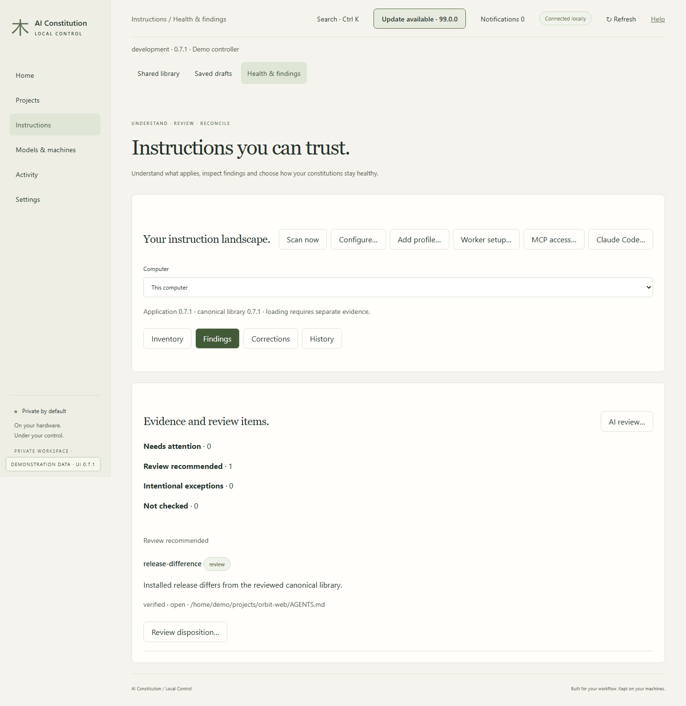

## Review health findings

Verified structural findings and contextual review items remain distinct. Coverage gaps are explicit.

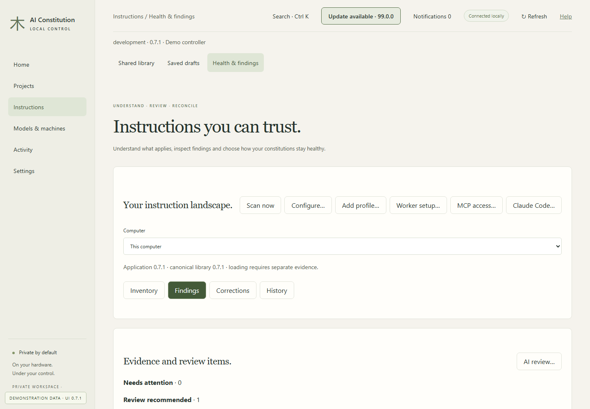

## Explain instruction discovery

Expected applicability is separate from client loading. Record the version and evidence from a fresh session.

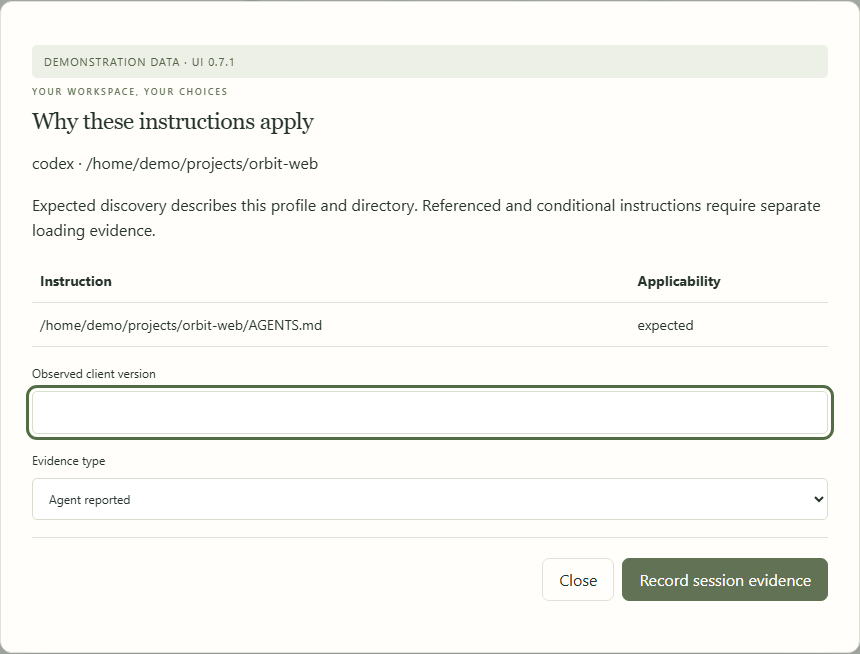

## Choose scope and correction policy

Select profiles, roots, notification behavior and permitted managed updates. AI prose always needs review.

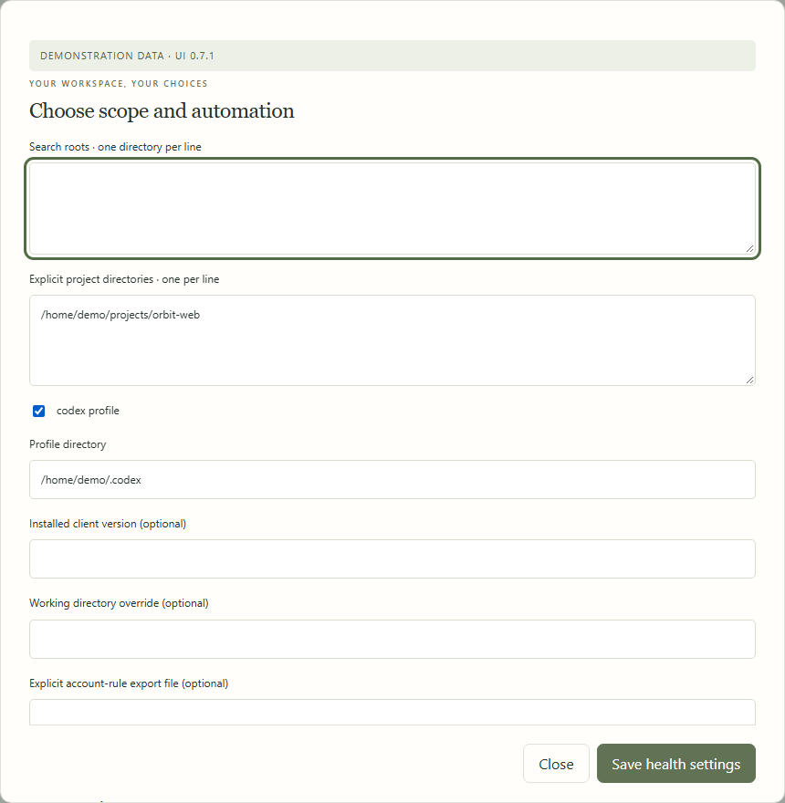

## Inspect eligible targets

Preview installation corrections before adoption. Pins and local edits stay protected.

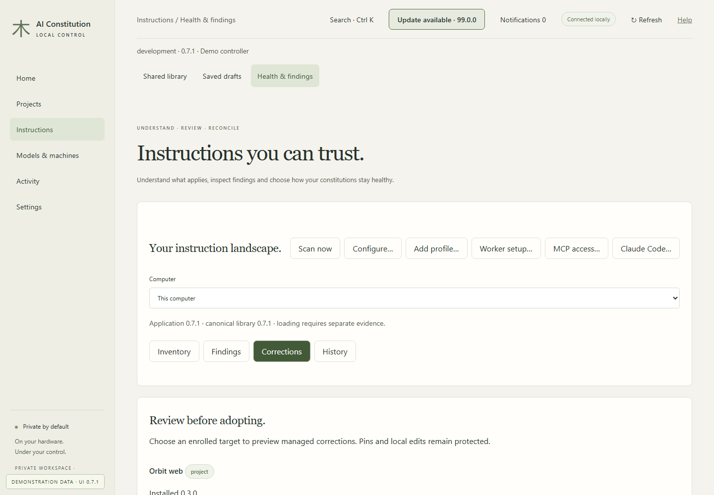

## Review a correction diff

Check the exact files and correction type. The fixture applies nothing.

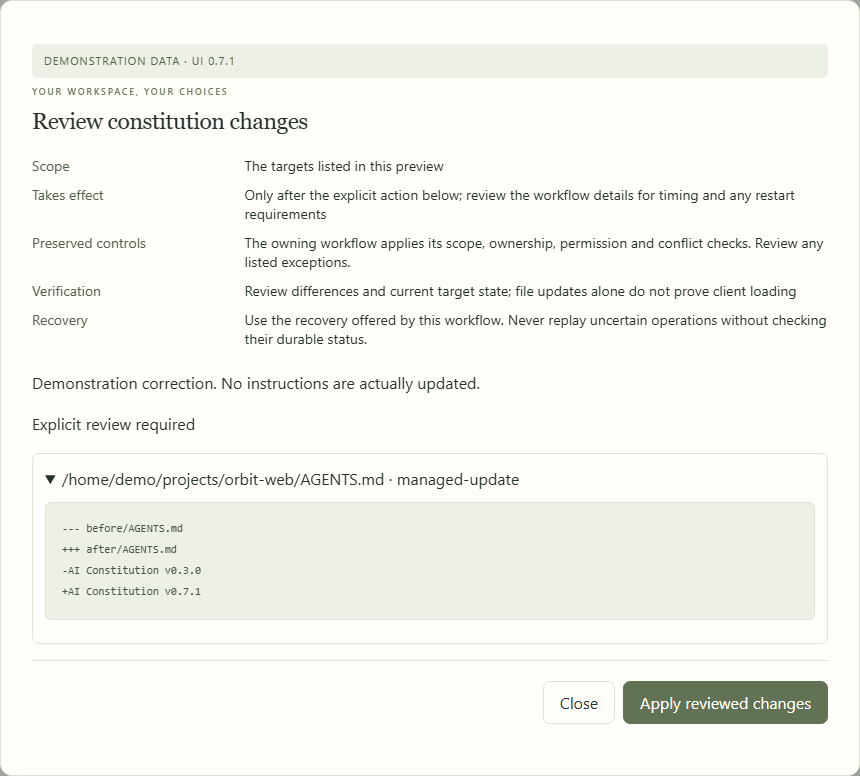

## Review history and recovery

Evidence backups preserve history. Restoring them does not re-enable permissions, schedules or corrections.

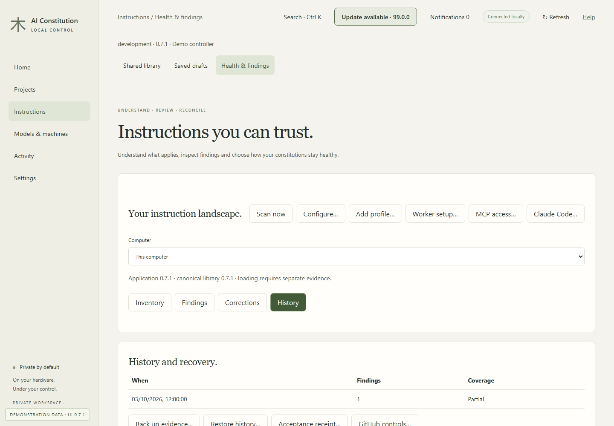

## Prepare a client review

Use the bounded snapshot with Codex or Cursor and import structured results. Unverified unattended execution uses the interactive handoff.

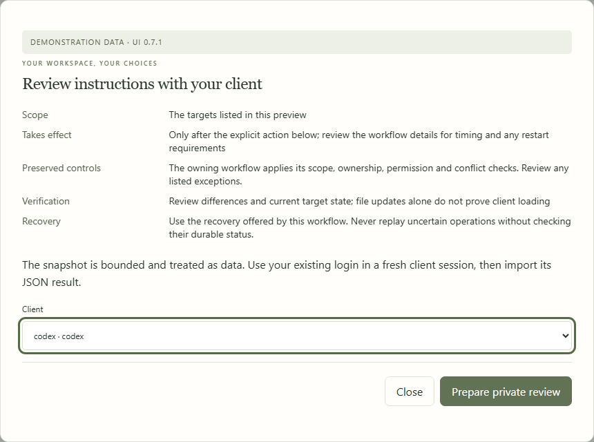

## Grant worker access locally

Inference pairing grants no instruction-file access. Choose roots and permissions on the worker.

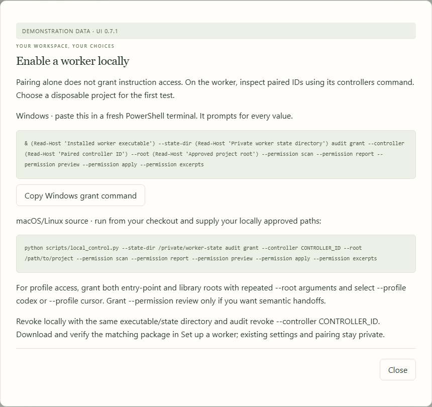

## Add a custom client profile

Choose the owning client configuration directory and a unique profile ID. Unavailable sources remain coverage gaps.

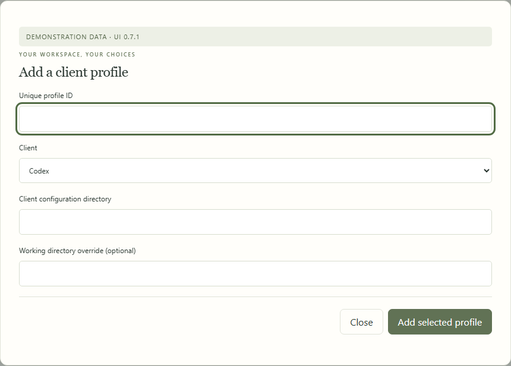

## Choose one target correction policy

Automatic corrections require both selected types and approval of the exact library. Project pins and pauses remain authoritative.

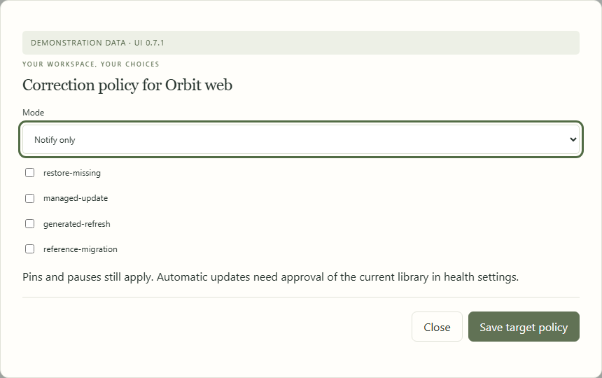

## Grant bounded MCP access

Choose a project and client profile. The bridge can inspect, scan and propose; apply and permission changes stay outside its tools.

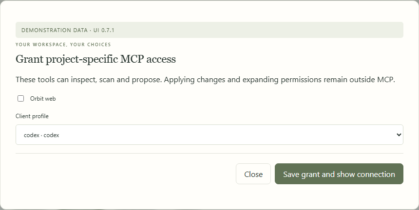

## Record separate delivery evidence

Implementation, review, integration, deployment and acceptance have independent evidence. Unknown and not applicable are valid states.

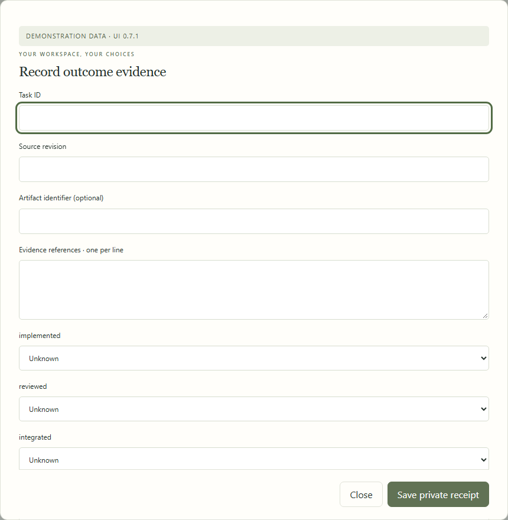

## Compare GitHub controls

Read observable controls using an existing login. Compare optional project governance without changing protections or merging candidates.

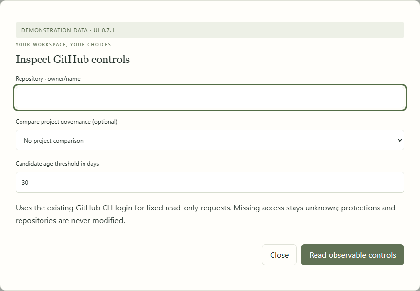

## Inspect health on a smaller screen

The instruction inventory uses the same controls on a smaller viewport. This is browser layout coverage, not a native mobile app.

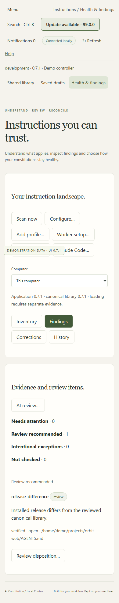

---

[Back to all workflows](README.md)
