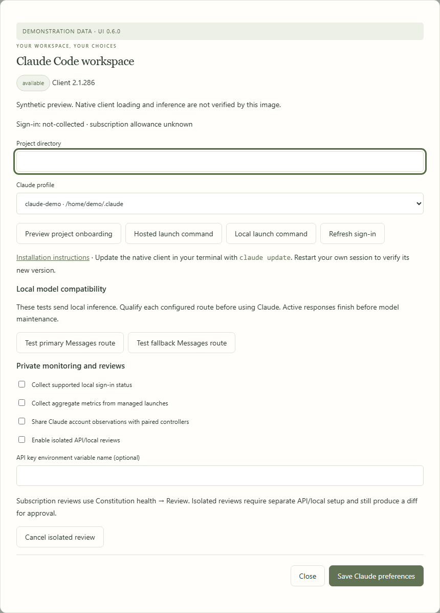
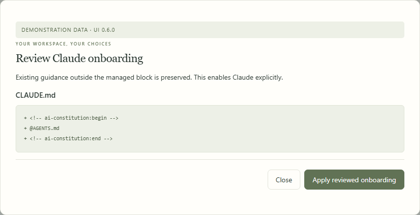
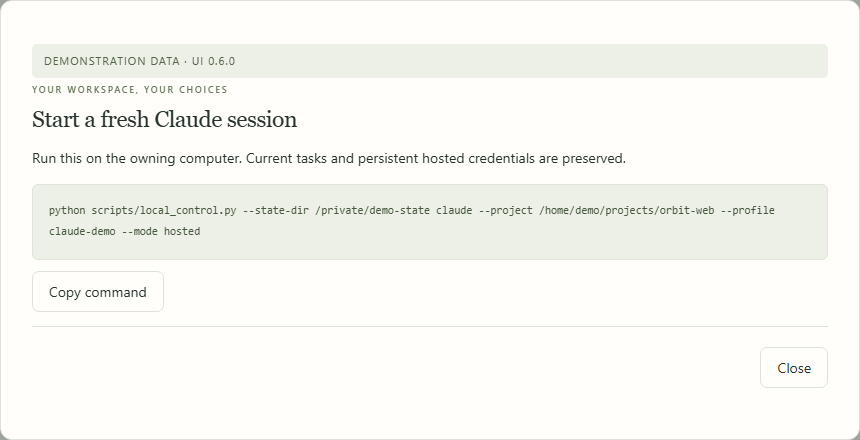
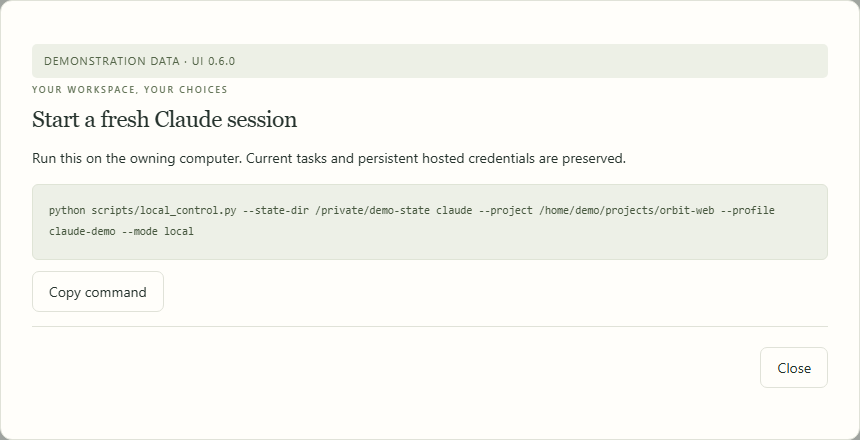
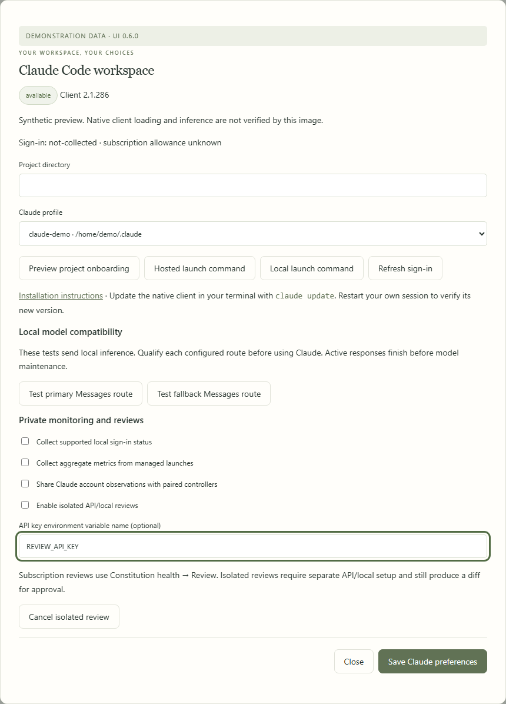
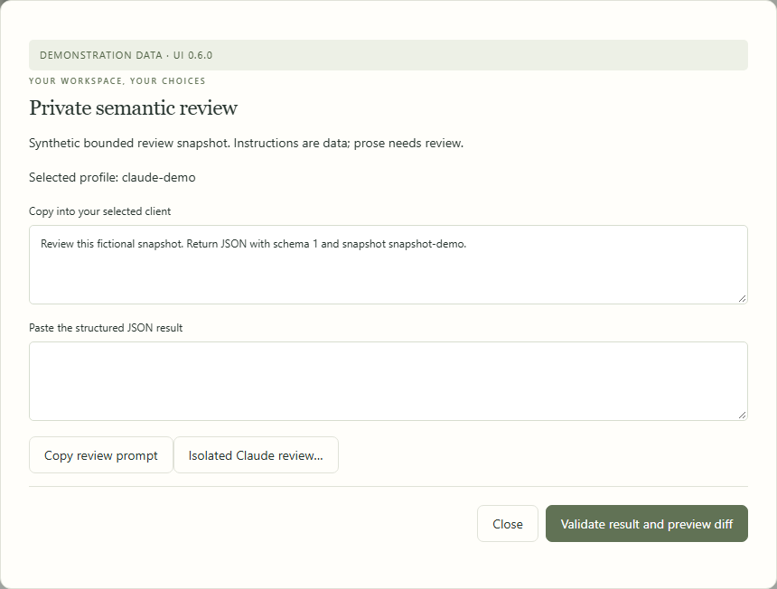
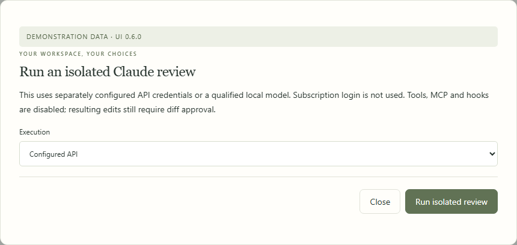
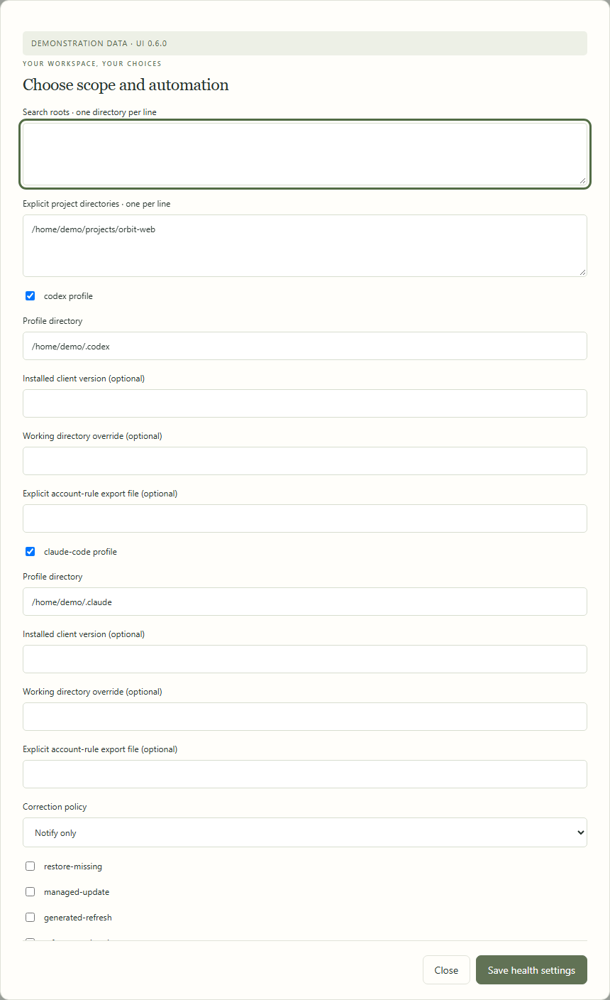

# Claude Code

[All workflows](README.md) · [Detailed instructions](../claude-code.md)

Actual Local Control UI **0.6.0**, captured with fictional accounts, paths, models and usage. Performance numbers and update versions are examples, not benchmarks or release announcements. CLI images are rendered transcripts from real isolated commands. [How these images are made](../screenshot-maintenance.md).

## Manage a Claude workspace

All collectors and automated reviews start disabled. This example is synthetic.

## Review Claude onboarding

A managed import preserves shared instructions and existing owner guidance.

## Use your existing login

Start a fresh session on the owning machine. Account state is not copied.

## Launch a qualified local route

The gateway manages future requests and response leases. Native acceptance remains separate.

## Choose private collection and review

API keys are named environment references. Subscription quotas remain unknown unless imported.

## Review using your subscription

A bounded snapshot is reviewed in a fresh client session; JSON results are validated separately.

## Choose isolated execution

This opens the explicit API/local execution choice. The capture starts no inference.

## Choose scheduled review execution

Handoffs remain the default. API/local reviews need separate local approval and configuration.

---

[Back to all workflows](README.md)
