# Projects-first workspace

[All workflows](README.md) · [Detailed instructions](../projects-first-usability.md)

Actual Local Control UI **0.7.0**, captured with fictional accounts, paths, models and usage. Performance numbers and update versions are examples, not benchmarks or release announcements. CLI images are rendered transcripts from real isolated commands. [How these images are made](../screenshot-maintenance.md).

## Your workspace

Synthetic preview of the projects-first workspace.

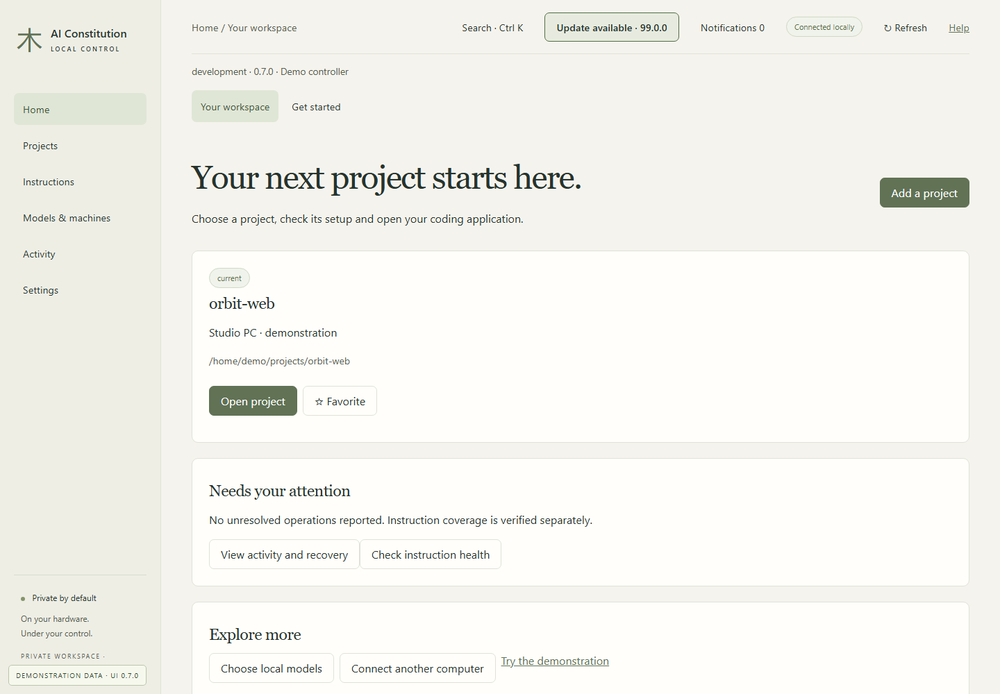

## Choose a project

Synthetic preview of the projects-first workspace.

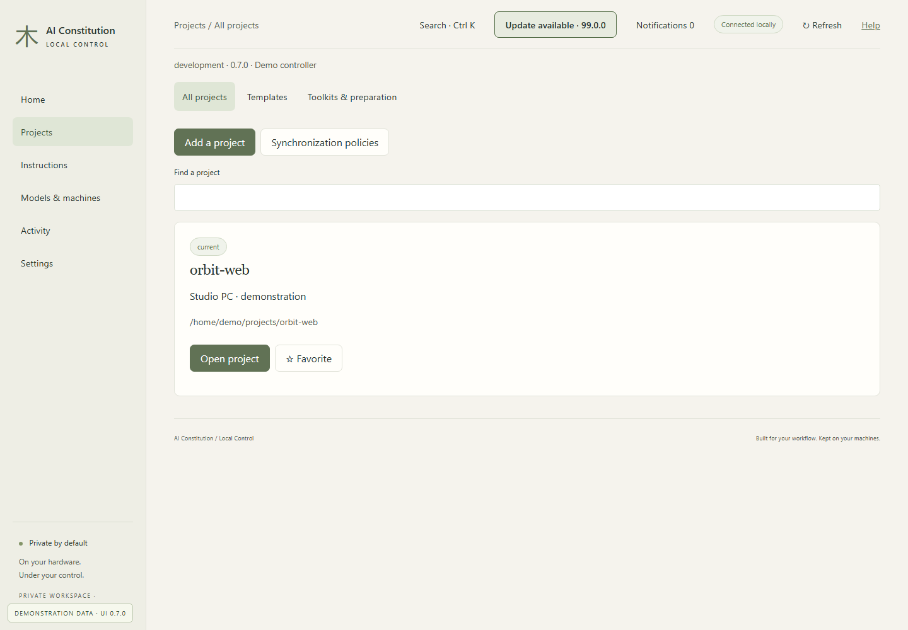

## Connect a coding project

Synthetic preview of the projects-first workspace.

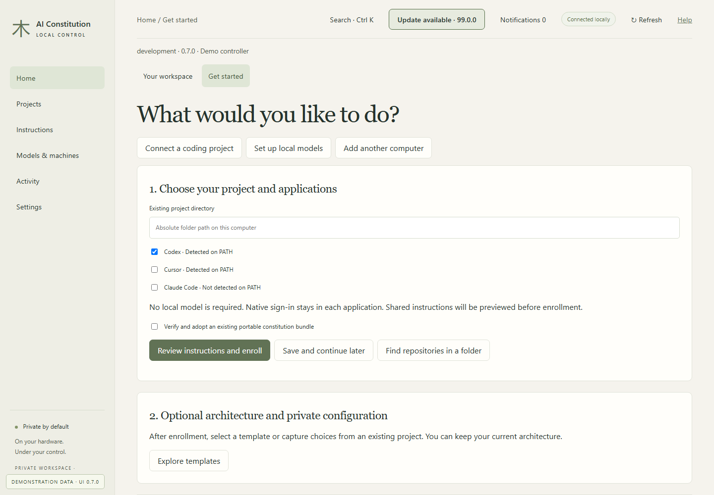

## Guided worker setup

Synthetic preview of the projects-first workspace.

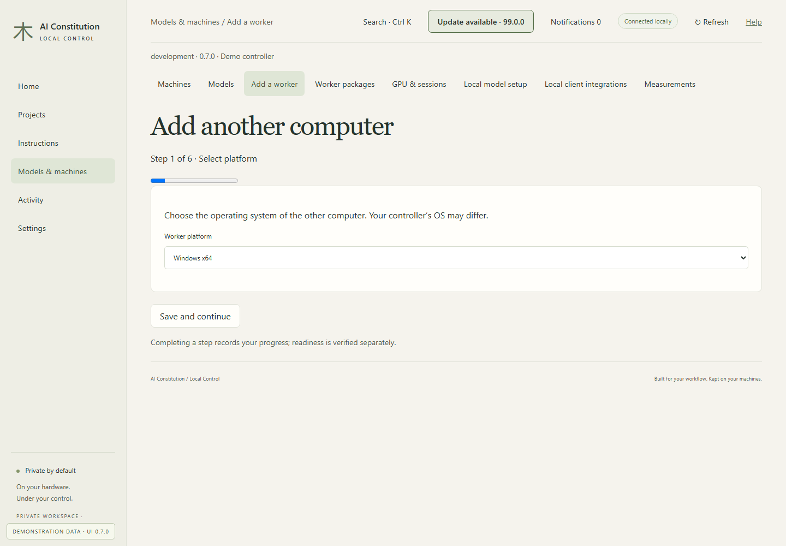

## Private instruction candidates

Synthetic preview of the projects-first workspace.

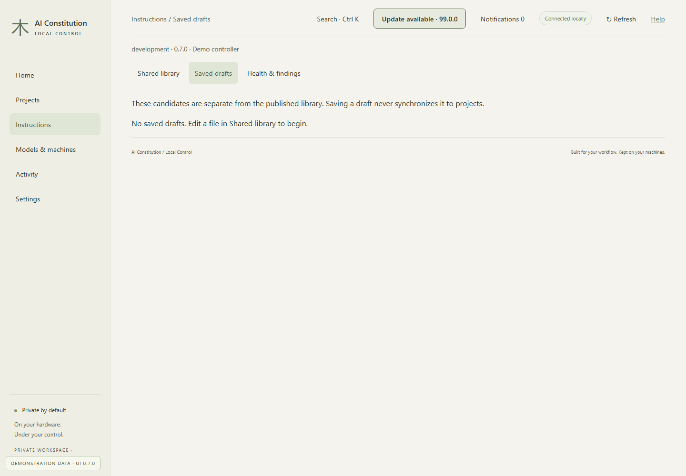

## Operations and recovery

Synthetic preview of the projects-first workspace.

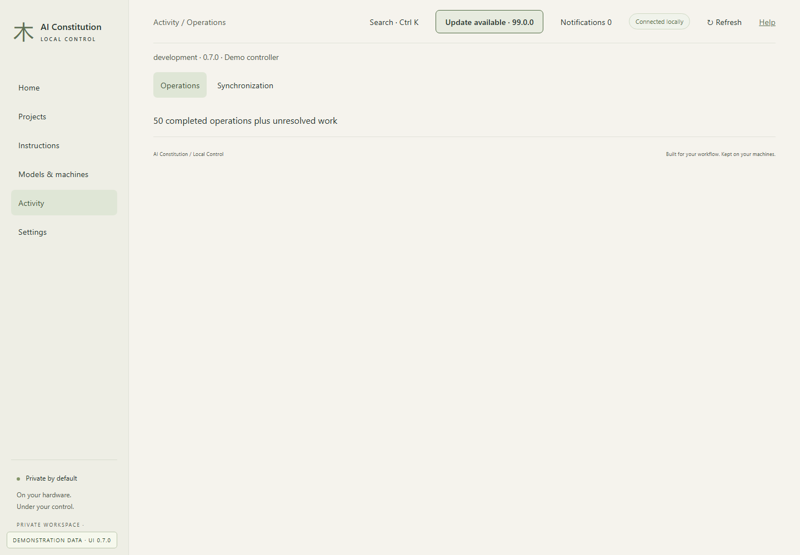

## Startup and help

Synthetic preview of the projects-first workspace.

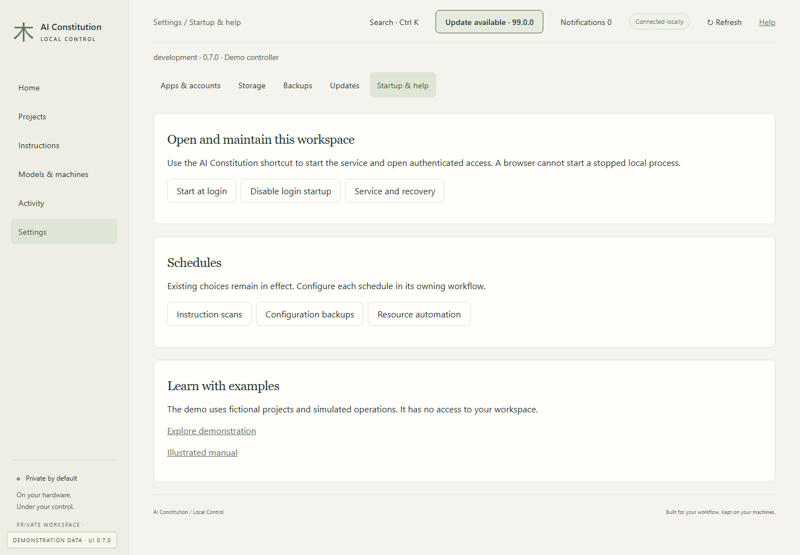

## One project home

Read installation, loading and model evidence separately.

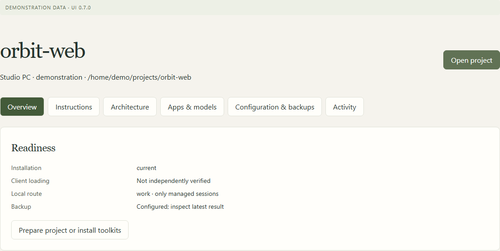

## Choose an application and account

Native sign-in is unchanged; hosted operation does not require a local model.

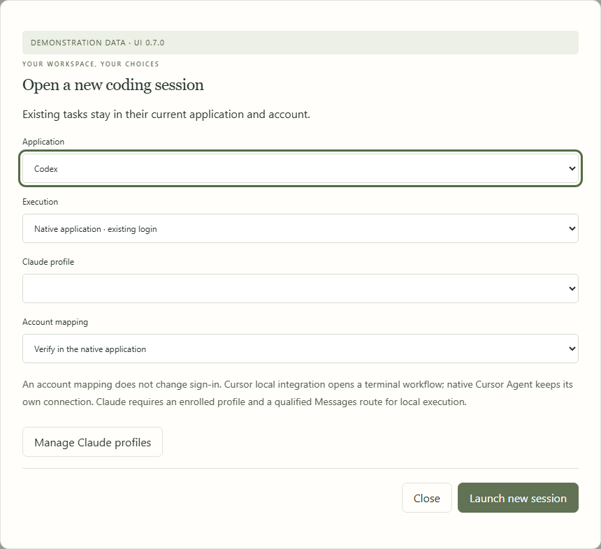

## Start in a fresh terminal

Every command names the executable and private state location; pairing and file grants remain separate.

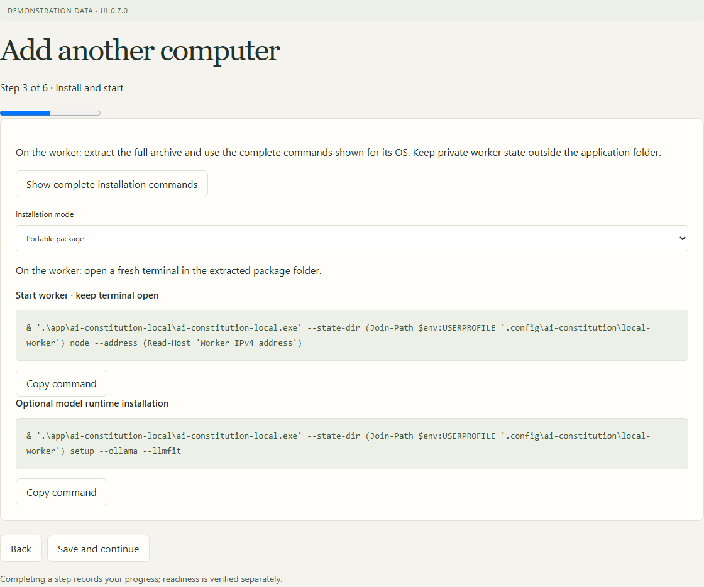

## Publish reviewed candidates

Candidates do not propagate until publication. Existing follow, pause and pin policies remain authoritative.

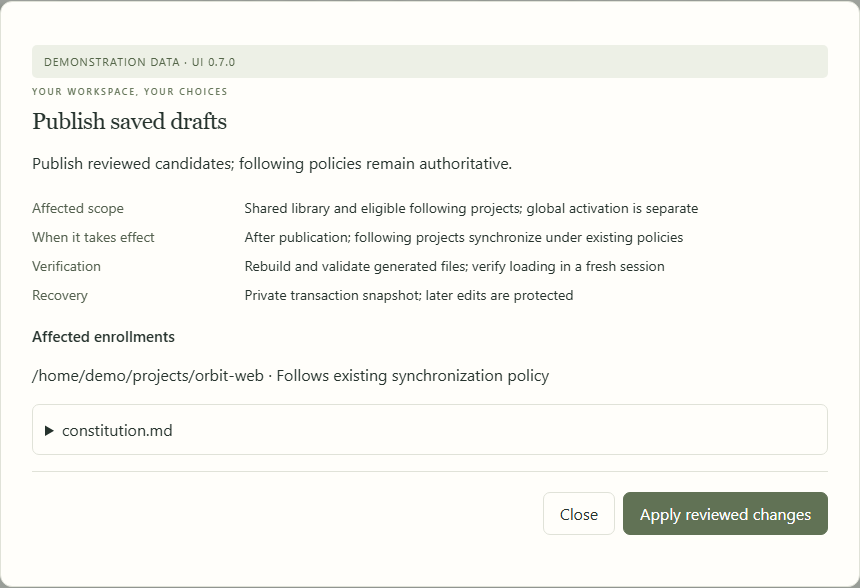

## Edit routing preferences

Structured fields preserve the source document; save a candidate and review publication before affecting projects.

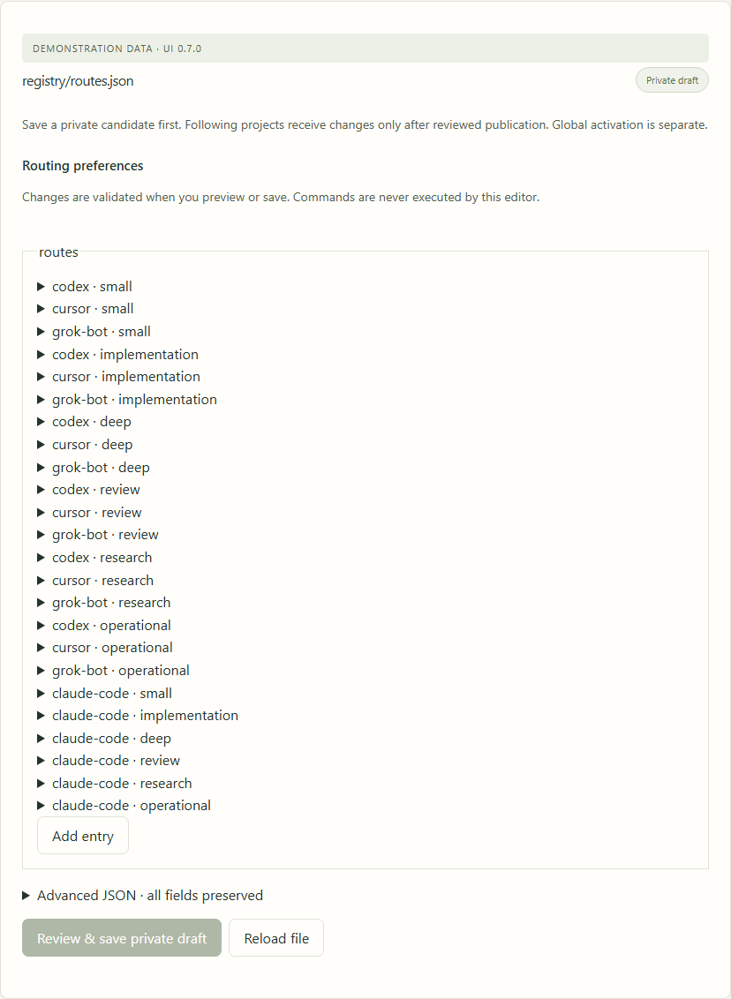

## Explore without host access

Fictional projects and simulated operations live only in memory; network connections are blocked.

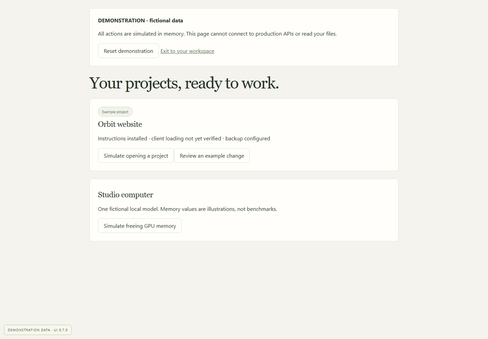

---

[Back to all workflows](README.md)
