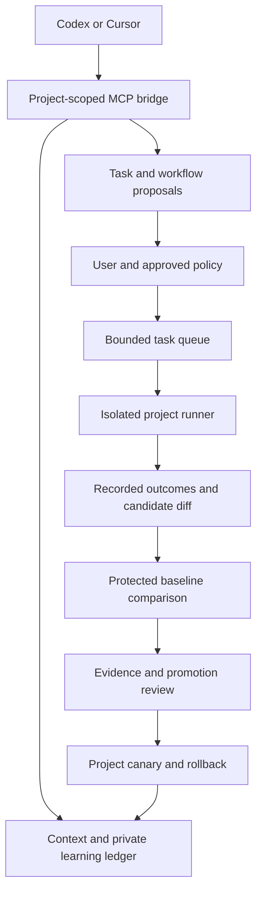

# Project improvement and MCP implementation plan

Status: proposed; implementation has not started. Written on 2026-10-06 against the v0.4.0 architecture. Names for new modules, tools and commands below are proposed interfaces, not commands available in the current release.

The [Constitution health](constitution-health.md) implementation now supplies instruction inventory, private SQLite evidence, scoped worker reports, reviewed correction receipts and an optional scoped MCP bridge. Reuse those records and permissions for this roadmap. Project coding, protected comparative evaluation and automatic workflow promotion remain proposed; avoid a second competing inventory or evidence database.

## Outcome

Connect an enrolled project to AI Constitution so agents can retrieve relevant context, record outcomes and propose better ways of working. Add an optional runner that completes approved project tasks, evaluates proposed workflow changes and presents evidence before those changes become defaults.

There are two separate outputs: changes to a project's code, tests or documentation; and changes to the instructions, skills, preparation recipes, tools or model routes used to do that work. A successful code change does not automatically prove that its workflow should become a shared default. This system improves versioned workflows, not model weights.

For example, repeated failures caused by a missing project preparation step can produce a proposed recipe change. The system replays representative tasks with the old and new recipes, reports the results and offers a project-specific promotion. It retains the old recipe if the comparison fails or is inconclusive.

The first useful release is a local MCP connection, project-specific lessons and an observation/proposal dashboard. Background execution and automatic adoption arrive behind later acceptance gates.

## Architecture and existing foundations

Keep access, execution and evaluation separate. MCP provides tools, resources and prompts; the controller owns the queue and permissions. An MCP connection alone does not supply a continuous agent runner. See the [MCP architecture](https://modelcontextprotocol.io/docs/2026-07-28/learn/architecture).

Reuse these existing components, with focused extensions:

| Existing component | Use in this feature |
| --- | --- |
| `local_control/toolkits.py` | Managed client configuration, skills, commands and MCP installation previews |
| `plans.py`, `rollouts.py` | Fingerprinted previews, checkpoints, project canaries and non-destructive rollback |
| `operations.py`, `core.py` | Visible jobs, process identity, cancellation and controller stop/update blockers |
| `studio.py`, `project_setup.py` | Enrolled project context, private instruction drafts and preparation recipes |
| `services.py` | Opt-in scheduling, backoff and controller lifecycle integration |
| `locations.py`, `storage.py`, `project_vault.py`, `recovery.py` | Private storage selection, permissions, backup and recovery integration |
| `model_lab.py`, [route evaluation guidance](../checks/evaluation.md) | Existing bounded fixtures and measurement conventions |

The current model lab measures local fixtures; it is not a project evaluator. The current workflow dispatcher exposes controller administration; it is not an appropriate unrestricted MCP API. Fleet sharing and inference-worker pairing do not authorize remote code execution.

Add a small `local_control/learning/` package for contracts, storage, policy, context, queue, execution, evaluation and promotion. Keep the optional MCP adapter separate from these services. The instruction toolkit and existing standard-library controller must still run without MCP dependencies.

## Delivery sequence

Use one reviewable pull request per milestone, splitting execution adapters if necessary. Milestones build in order; Cursor execution can proceed independently after the runner contract is stable.

| Milestone | Deliverable | Acceptance gate |
| --- | --- | --- |
| 0 | Compatibility spike and permission contract | Real client handshake; documented execution limits on each target OS |
| 1 | Private learning ledger and scoped policy | Migration, isolation, provenance and restart tests pass |
| 2 | Local MCP and managed onboarding | Codex and Cursor retrieve scoped context and record a test observation |
| 3 | Observation/proposal workflow and dashboard | Useful lessons and reviewable proposals without modifying project defaults |
| 4 | Bounded project runner | One approved task produces an isolated diff; budgets and cancellation work |
| 5 | Protected project evaluation | Baseline/candidate comparison rejects a deliberately weaker candidate |
| 6 | Reviewed promotion and rollback | Canary adoption and reversal preserve later user edits and project ownership |
| 7 | Opt-in continuous operation, recovery and release | Interrupted runs, backups, upgrades and documented pilot acceptance pass |

### 0. Verify client compatibility before committing to adapters

- Select and pin a tested official Python MCP SDK in an optional `requirements-mcp.txt`. Verify protocol negotiation, resources, prompts, tool errors, cancellation and packaged execution. Update dependency/license inventories and build provenance when this dependency is introduced. Do not implement a private approximation of the protocol.
- Test the bridge with real Codex and Cursor clients; keep automated protocol tests independent of accounts and paid inference. Record client versions and distinguish configuration installed, server connected and a tool successfully called. Codex supports local stdio and Streamable HTTP connections in its [MCP documentation](https://learn.chatgpt.com/docs/extend/mcp?surface=cli).
- Use Codex CLI as the first execution adapter. Non-interactive execution is a smaller integration than controlling existing desktop conversations; persistent app-server integration can follow later. See [Codex platform interfaces](https://developers.openai.com/blog/codex-as-a-platform).
- Cursor documents native Windows, WSL, macOS and Linux installation, plus headless output and CLI-specific permissions. Test the exact combination used for each adapter. Its documented unattended write mode bypasses confirmations; enable writes only when an independent execution boundary is verified. See [installation](https://prod.cursor.com/docs/cli/installation), [headless execution](https://prod.cursor.com/docs/cli/headless) and [CLI permissions](https://prod.cursor.com/docs/cli/reference/permissions).
- Produce a capability matrix: interactive MCP, proposal-only runs, restricted editing, test execution, cancellation, usage reporting and supported authentication. A missing capability disables that mode rather than silently broadening permissions.

**Done when:** a harmless real-client MCP check passes, fake-agent execution fixtures work, and each promised execution mode has a recorded permission/isolation contract. Installed account access or API access is not evidence that every model or subscription entitlement supports unattended execution.

### 1. Add the private learning ledger and policy

- Use standard-library SQLite for transactional events and queryable run summaries, with bounded private artifacts alongside it. Keep this under a configurable learning-state location outside the public checkout. Serialize migrations, reject unknown schemas and prevent symlink/reparse-point escapes.
- Define versioned records for projects, approved tasks, runs, observations, lessons, candidate workflows, evaluation suites, comparisons, promotions and grants. Use opaque project IDs; resolve paths through existing enrollment, never caller-supplied arbitrary directories.
- Record task/base commit, instruction/toolkit hashes, client and model identity, route settings, environment fingerprint, evaluator version, attempts, elapsed time, test outcomes, human corrections and reported usage. Label agent reports separately from controller measurements and independently verified results. Unknown usage remains unknown.
- Separate read-context, record-observation, propose-change, enqueue-approved-task and request-evaluation permissions. Grants have project scope, issuer, permitted operations, expiry/revocation and run limits. They cannot be minted or expanded by an agent. A preview hash proves integrity, not authorization.
- Add request idempotency, per-project locks, execution leases and an event trail. Append events through the service and retain immutable referenced versions; do not describe locally writable state as tamper-proof. Apply retention and deletion controls to both database records and artifacts.
- Collect selected metadata by default. Do not ingest credential files, central environment files or entire conversations. Explicitly imported content remains untrusted data; limit size, validate types, redact sensitive fields and suppress unsafe exports. Redaction does not authorize publishing private material.

**Done when:** duplicate events cannot duplicate work; one project cannot read another project's data; revoked grants fail; unknown schemas fail safely; restart and retention tests preserve valid history without replaying uncertain work.

### 2. Ship a narrow local MCP bridge

Start with stdio. If the dashboard is running, use a dedicated authenticated loopback service interface; do not reuse its browser admin session, inference token or worker admin credential. If it is unavailable, context may be read through a bounded read-only path; queue mutations return a clear unavailable response. There is one owner of queue execution.

Initial proposed contract:

| Interface | Purpose | Required scope |
| --- | --- | --- |
| `project_context` resource | Approved project facts, instructions, constraints and version identifiers | Read selected project |
| `project_lessons` resource | Applicable verified lessons, with provenance and expiry | Read selected project |
| `prepare_task` prompt | Assemble bounded context and explicit task acceptance criteria | Read selected project |
| `record_observation` tool | Submit a typed outcome; agent claims remain labelled | Record selected project |
| `propose_improvement` tool | Store a candidate diff and hypothesis for review | Propose selected project |
| `get_run` tool | Return bounded status, evidence and uncertainty | Read selected project |
| `enqueue_task` / `request_evaluation` tools, added later | Reference an approved task or comparison; return a job ID | Explicit execution/evaluation grant |
| `cancel_run` tool, added later | Request cancellation of a run owned by this grant | Cancel owned run |

No generic shell tool, arbitrary controller dispatch, unrestricted file reader, credential reader, permission editor or agent-accessible promotion tool. Validate every operation in the service even if the client has already approved its tool call. MCP roots and tool annotations are not security boundaries. Bound response sizes, pagination, request rates and outstanding jobs; do not hold a tool call open for an entire experiment.

Extend toolkits with a built-in connection recipe and previewed native configuration. Store credentials only through private environment references and preserve unrelated MCP entries and client approval settings. Test a fresh session before reporting the connection as working. The existing local Codex launcher disables plugin/app features: selectively enable the required connection after compatibility testing, without enabling every external integration or changing an active session.

**Done when:** both clients can retrieve context and submit an observation, while cross-project requests, administrative actions, oversized inputs and unauthenticated controller requests are rejected. Removing MCP dependencies leaves existing commands operational.

### 3. Make observation and proposals immediately useful

- Provide a small task-completion skill/command that records agreed acceptance results, corrections and recurring friction. Use documented client events or explicit agent reports; do not depend on scraping account tokens or all desktop transcripts. Record collection gaps visibly.
- Generate project-specific lessons with evidence links, applicability conditions, confidence category and expiry. Deduplicate repeats, surface conflicting lessons and mark obsolete environment-dependent advice stale. A suggestion is not an instruction until reviewed and versioned.
- Assemble context according to task type and a bounded size budget. Include current project facts, applicable instructions and selected lessons, with an explanation of inclusion. Keep secrets and unrelated account metadata outside this context.
- Propose concrete changes to project overlays, toolkit assets, preparation recipes and optional routes. Show the intended scope and before/after diff. New model definitions establish availability metadata; performance claims require separate evaluation. Preserve the normal catalog/build pipeline for generated routing files.
- Add a **Project improvement** dashboard page with connection status, observation history, lessons and proposal review. Include keyboard navigation, empty/error states, clear evidence labels and a visible disabled execution state.

**Done when:** a synthetic task history produces a relevant, traceable proposal, conflicts are understandable and the user can reject or revise it without altering the enrolled project's defaults.

### 4. Add bounded project execution

- Accept explicitly approved backlog items with a base revision, scope, acceptance criteria, allowed commands/network access and limits. Unapproved suggestions remain suggestions. Work only in managed isolated checkouts; leave the user's working tree intact. Block incompatible concurrent operations on the same project.
- Create fresh run configuration, a minimal environment and an explicit credential access boundary. A Git worktree is not an OS sandbox. Verify native client confinement; isolate arbitrary project/test commands separately with an appropriate restricted environment. Do not expose host configuration, unrelated repositories, unrestricted network access or a Docker socket by default. If confinement cannot be enforced on a platform, keep it in observation/proposal mode.
- Run subprocesses with argument arrays, controlled directories and tracked process identity. Use the client's documented authentication; let the user sign in normally. Do not copy account credentials between computers or infer that subscription logins are interchangeable. Preserve required client state without granting general access to private home directories.
- Implement durable states: queued, preparing, running, validating, awaiting review, completed, failed, interrupted and cancelled. Store checkpoints before side effects. After restart, mark uncertain work interrupted and require an explicit resume decision; never blindly replay an agent or Git operation.
- Start with Codex, then add Cursor after its independent acceptance gate. Keep actual xAI Grok Bot support through existing context/onboarding exports until a supported local execution interface is verified. A future hosted API adapter needs separate authentication and paid-budget authorization.
- Proposed pilot limits: one active run across the controller, one project, 30 minutes per run, at most three repair attempts, no automatic follow-up tasks and zero direct paid-API budget. Freeze final limits in the pilot policy. For subscription runs, display known quotas and enforce time/run/attempt caps; do not advertise a hard monetary cap when billing is unavailable. Reserve enforceable budgets before dispatch and stop scheduling when usage evidence is stale or required limits cannot be enforced.
- Pause stops new work and checkpoints the current run where possible. Cancellation terminates only owned execution safely, marks unfinished validation explicitly and preserves artifacts. Integrate controller update/stop readiness with these runs. Preserve inference response leases, Gaming mode and the user's existing chats; do not kill an unrelated client session or switch its model mid-task.
- Deliver a local diff and validation report for review. Creating a draft PR is an explicit policy option; merging, publishing and deploying require their own authorized scope.

**Done when:** a fake agent and then an opted-in real pilot task produce a reviewed diff; budget exhaustion, blocked permissions, cancellation, controller updates and crashes cannot cause duplicate work or mutate the user's checkout.

### 5. Evaluate project workflows against a protected baseline

- Build a separate project evaluator. Freeze representative task inputs, expected results, commands, evaluator source and environment versions before trying candidates. Protect evaluator assets outside the candidate's writable scope; run candidate code under the execution boundary. Candidate-added tests may supplement acceptance but cannot replace or weaken the checks used to judge that candidate.
- Compare baseline and candidate from the same starting revisions and task inputs in fresh environments. Change one workflow factor at a time initially. Randomize paired run order where practical and record failures, cancelled trials and human interventions instead of discarding them.
- Begin with five representative task types and aim for at least three paired runs per type, subject to the authorized budget. These are pilot starting points, not statistical guarantees. Keep a separate held-out set out of optimization context; expand it as real failure patterns emerge. Repeated tuning against one visible set is not independent validation.
- Make correctness and critical regressions hard gates. Compare acceptance completion, retries, human corrections, median elapsed time and actual reported usage; show spread and sample count. Report tail latency only when sample size supports it. Human review assesses maintainability and meaningful omissions; agent self-grades are supporting observations only.
- Freeze the improvement threshold and allowed quality tolerances before each experiment. A proposed initial efficiency threshold is 10% with no quality loss, but noisy or undersampled results are **inconclusive**. A higher-quality result can justify review even without a speed gain. Do not collapse quality and cost into a score that hides a correctness regression.
- Distinguish measured usage, estimated API prices and subscription quotas. Do not present flat-subscription token estimates as billed savings. Account for evaluation overhead when reporting whether a workflow actually saves time or cost.

**Done when:** deterministic fixtures reject a faster but incorrect candidate, detect evaluator tampering, retain an inconclusive baseline, and show reproducible evidence for an improved candidate. Live comparisons remain opt-in; CI uses fixtures and fake clients.

### 6. Promote through project canaries and preserve rollback

- Produce a fingerprinted promotion preview linking the candidate, evaluation suite, result set, project versions and policy grant. Recheck source versions, permissions, enrollment, pins, pauses and conflicts immediately before writing. An evaluated version must match the version being adopted.
- Start with human-reviewed project overlays and toolkit/recipe changes. Canary one project, observe the next agreed tasks and retain a previous version for rollback. Keep generated files under their existing build process and managed-block ownership rules.
- Display which enrolled projects are eligible for synchronization, which remain pinned/paused/conflicted and which sessions require a restart to load instructions. Files synchronized is a different state from instructions loaded. Apply reviewed shared changes through existing eligible-project synchronization; do not overwrite local refinements.
- Roll back owned changes through existing journals, preserving user edits made after promotion. Reject an unsafe automatic reversal and present a repair diff. Keep the evidence and rejection history so failed experiments are not proposed repeatedly.
- Require evidence across different eligible projects before recommending a global default; use three distinct project contexts as an initial breadth goal, with a held-out canary and explicit review. That number is not proof of universal superiority. Project-local findings remain local when their scope does not generalize.
- Changes to AI Constitution executable source, security policy or evaluator code use separate tested PRs. The active controller cannot replace its own running executable or grant itself new authority. Optional automatic project-scoped adoption is a later policy mode, limited to specifically approved change types and evaluation gates.

**Done when:** a reviewed candidate can be canaried and reversed, stale plans and conflicts fail safely, and a project-local lesson cannot silently become a global rule.

### 7. Complete the control center, recovery and release

- Finish a setup wizard: choose enrolled project, verify connection/capabilities, select observation or assisted execution, review grants, set budgets and define acceptance tasks. Observation is the default; bounded background operation requires a separate visible policy.
- Provide queue/run detail, baseline-versus-candidate evidence, traceable diffs, rejected experiments, budget consumption, upcoming runs, pause, cancel and rollback. Show why a run did not start. Notify on actionable completion, regression, exhausted budget or required review; suppress unchanged status noise.
- Add opt-in scheduling through controller services with idempotent triggers, bounded queues, backoff and circuit breakers. Run only approved ready tasks or approved comparisons; an empty queue stays idle. Initially the controller must be running and the computer awake. Do not imply an always-on OS service or perpetual agent conversation.
- Add consistent learning-state backup/restore using SQLite's backup mechanism and bounded artifacts, with encrypted backup integration, retention and recovery tests. Existing project-folder backups do not automatically cover a new ledger. Preview included data; never put grants, tokens or machine-specific execution authority into a portable recipe. Restore history without restarting pending work or reactivating old permissions.
- Keep remote execution out of this first release. A later cluster runner needs separate pinned authentication, execution grants, ownership leases, sandbox checks and physical Windows/macOS acceptance. Existing paired inference workers are not automatically trusted runners. Likewise, defer desktop conversation steering and unverified hosted-bot execution.
- Add deterministic synthetic screenshots and illustrated manual chapters only as the UI ships. Update feature boundaries, onboarding prompts, CLI reference, architecture, security guidance, dependency inventory, upgrade instructions and release provenance. Describe planned and verified capabilities separately.
- Upgrade from v0.4.0 with the feature disabled and no implicit grants. Test migration, missing optional dependencies, schema incompatibility, interrupted experiments and non-destructive rollback. Retain existing local-model and public-release security gates.

**Done when:** an opted-in pilot completes the full task/evidence/promotion/rollback cycle, recovery and restart preserve its state, and public documentation accurately matches tested behavior.

## Verification and pilot acceptance

The implementation test suite must cover protocol interoperability; private path and cross-project isolation; revoked/expired grants; malformed and injected observations; idempotency and concurrent requests; restart at every side-effect boundary; bounded subprocess output and process cleanup; permission failures; evaluator protection; misleading/missing usage; stale promotion previews; conflicting user edits; and consistent backup/restore. Use temporary homes/projects and fixtures, with no paid inference or live client configuration writes in automated tests.

Run the existing constitution check, unit suite and public secret scan for implementation PRs. Extend Windows, macOS and Linux CI with optional-SDK smoke tests, fake runtime adapters and migrations. Real-client acceptance is separate from CI: record OS, client version, mode and evidence, and only claim verified combinations. Dashboard journeys must include accessible setup, unavailable clients, empty queues, interrupted runs, inconclusive comparisons and rollback conflicts.

Select one non-critical enrolled pilot project when implementation reaches activation. Record its repository scope, client/account choice, approved tasks, command/network permissions, time/usage limits, test suite and desired improvement measure. These are activation inputs, not prerequisites for writing the feature or this plan. The pilot starts in observation mode, progresses to manually initiated isolated runs and only then enables bounded scheduling.

Release the runner as a preview until it demonstrates: useful task output reviewed by the user; a traceable workflow proposal; a valid controlled comparison; a deliberately regressive proposal rejected; a successful project canary and safe rollback; and reliable pause/restart/recovery. Report the pilot's sample size and evaluation overhead. Do not claim universal superiority or savings without measured evidence.

## First implementation slice

Implement milestones 0-2 first: compatibility tests, scoped private contracts and a read/record/propose MCP connection. Include a minimal connection-status page and reproducible Codex/Cursor setup instructions. This supplies immediate value and establishes trustworthy permissions and data before adding autonomous execution. Milestone 3 then turns those records into useful reviewed lessons and proposals; milestones 4-7 complete the bounded loop.
